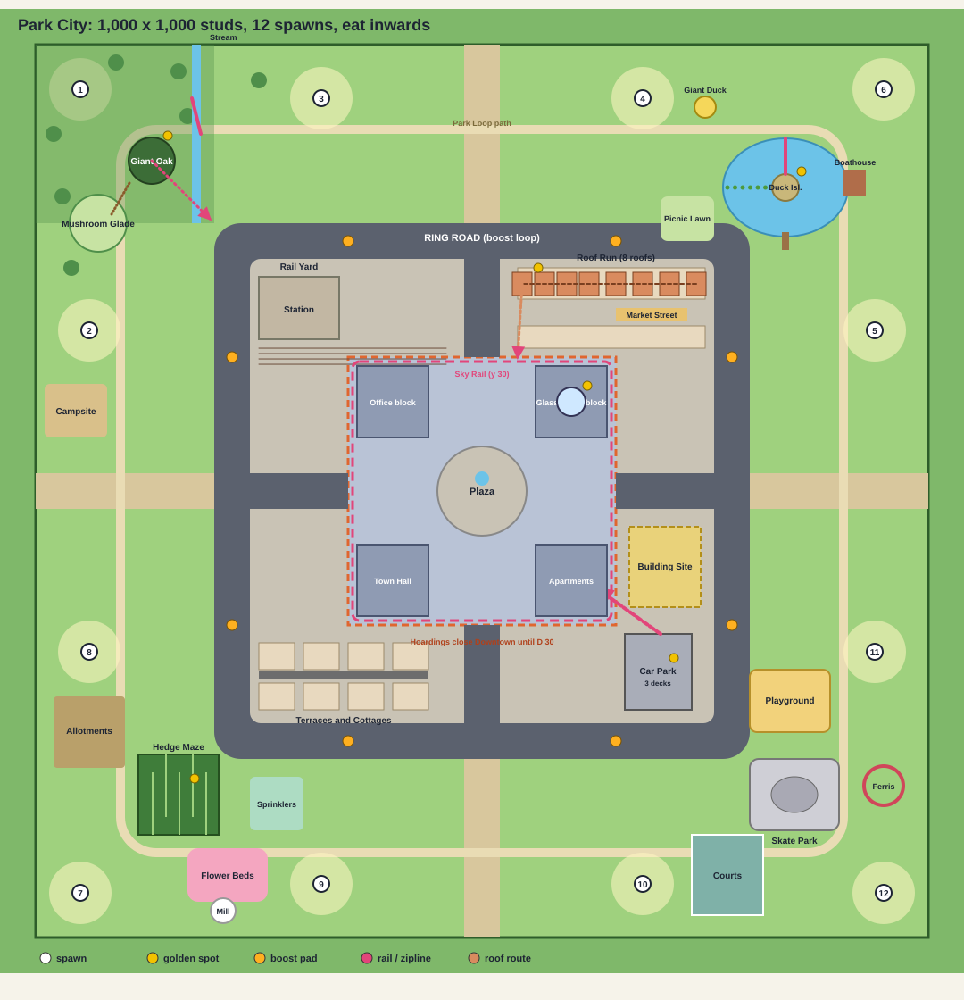

# Level design: Park City

Status: **v2, approved 2026-11-04.** A level design written from scratch after feature 010 (Main-Street slice). The owner
approved the map, the speed cap and the four new mechanics on 2026-11-04 (section 15). v2 adds the owner's review of
v1:
- a smaller start and a new size rule (sections 3 and 4);
- a calculated challenge budget (section 5);
- placement that makes sense (section 6);
- catapults;
- random events;
- two new modes;
- the winter ice pond.

It replaces the Downtown "Inside Out" layout in [03-city-level.md](03-city-level.md) as the plan for the launch map.
The art direction ([08-style-bible.md](08-style-bible.md)) is unchanged. Every number marked **(tune)** is a starting
value for playtests.

- **Layout data** (authoritative for every coordinate): [maps/park-city-layout.json](maps/park-city-layout.json), written
  by `scripts/park_city_layout.py`. Where a coordinate in this text and the JSON disagree, the JSON wins.
- **Maps**: the overview, one map per zone, close-ups of the set pieces and a Roof Run side view, all drawn from the
  JSON by `scripts/park_city_render.py`. See [maps/README.md](maps/README.md) for the list and how to read them.
- Growth model: `scripts/growth-sim.py`. Run it after you change a food count or a size rule; section 5 quotes its
  output.

---

## 1. Why the last two maps did not work

| Problem | In 008 / 010 | Rule in this design |
| --- | --- | --- |
| No destinations | Food spread evenly by zone fills and street rules. Every direction looked the same. | Every 30 to 40 s of play leads to a **set piece** you can see from where you are. |
| No challenge | Rolling was flat and safe. You could grow to the top without effort. | Food is **budgeted**: the open routes give the lower half of each tier, and the top half sits behind skill routes. The top tier is scarce and does not come back (section 5). |
| You could not tell what you can eat | The ball's heap looked three times its real size, and a long thin violin counted by its length (owner screenshot, D 6.5). | The heap stays the ball's size. The rule is about an object's **bulk**, not its longest side. Edible things near you wobble (section 4). |
| Random clutter | Objects scattered on open lawn, with no reason to be there, and you kept bumping into big ones. | **Every object belongs to a scene** that explains it. Big things stand at the back of a scene, and lanes stay clear (section 6). |
| Start in a box or a car park | 008 walled the start in, and 010 put a street in front of it. | You start **tiny, in a park**. The city is the horizon you grow into. |
| 12 players starved or never met | Start pads were private, and the end had no shared target. | **Spread out early, meet late.** Private doorsteps in the park, shared set pieces in the middle, one contested centre at the end. |

## 2. Design pillars

1. **Something your size within 3 seconds.** On every main route, at every tier, the next edible object is visible
   and at most 3 s of rolling away.
2. **Something just too big in view.** The next tier's food stands where you can see it.
3. **Effort decides the size.** A new player ends a run at about D 25, a median one at about D 55, a skilled one at
   about D 95. Nobody passes about D 110 in 4 minutes.
4. **Every place teaches one thing and rewards one skill.** Paths teach steering, lily pads jumping, the skate park
   ramps, catapults aiming, the roofs all of it.
5. **Today's hazard is tomorrow's lunch.** Hedges, fences, the lawnmower, the roundabout and traffic stop a small
   ball and feed a bigger one.
6. **Spread out, then converge.** Twelve balls start in four park quarters and are pulled inwards to a crowded
   Downtown for the last minute.
7. **Nothing is there by accident.** A stranger should be able to guess why every object is where it is.

## 3. Size, speed and jumps

All in studs (an avatar is about 5 tall).

### 3.1 Start smaller: D 1 (was 2)

A 1-stud ball sits among acorns, coins and petals, so the first 30 seconds are about tiny things, and the ball's
growth spans 100× instead of 50×. Changes: `startDiameter` 1, `cameraMinDistance` 4 (was 8). The jump floor
`minJumpClearHeight` 1.6 stays, so a tiny ball hops 1.6× its own size, enough for kerbs and roots.

### 3.2 The new size rule: bulk, not longest side

- **Bulk** = the cube root of the object's bounding-box volume (`(x·y·z)^(1/3)`), worked out from new `dims` data on
  every object.
- **Edible when `bulk ≤ 0.5 × D` and `longest side ≤ 1.5 × D`.** The second rule stops a ball eating a lamp post
  three times its height.
- **Growth uses bulk**: `D³ ← D³ + k·bulk³`, so a thin violin gives little and a chunky crate gives a lot.
- **Garnish**: an object with bulk under `0.08 × D` is still swallowed (the pop and the sound) but adds nothing, so a
  big ball cannot grow by mowing crumbs.
- For players, one sentence covers it: **"you can eat anything smaller than about half your ball."**

| Object (L × W × H) | Old rule: needs D | New rule: needs D |
| --- | --- | --- |
| Violin 3 × 1.1 × 0.4 | 7.5 | 2.2 |
| Bench 7 × 2 × 3 | 17.5 | 7.0 |
| Hatchback 14 × 6 × 5 | 35 | 15 |
| City bus 25 × 8 × 10 | 62.5 | 25 |
| Cottage 22 × 18 × 20 | 55 | 40 |
| Apartment block 40 × 20 × 30 | 100 | 58 |
| Glass Tower 35 × 35 × 90 | 150 (size 60) | 96 |

### 3.3 Tiers (rebuilt for D 1 and bulk)

| Tier | Ball D | Eats bulk | Name | Typical food | Where |
| --- | --- | --- | --- | --- | --- |
| 1 | 1 – 2.5 | to 1.25 | **Crumb** | acorns, coins, berries, petals, buttons, sweets, bottle caps | park floor, doorsteps |
| 2 | 2.5 – 6 | 1.25 – 3 | **Pocket** | mushrooms, flowers, apples, rubber ducks, toys, trainers, phones, cans | park set pieces |
| 3 | 6 – 15 | 3 – 7.5 | **Picnic** | gnomes, hedges, scooters, bikes, benches, bins, mailboxes, hot-dog trolleys, phone booths | park kit, gate corners, rooftops |
| 4 | 15 – 35 | 7.5 – 17.5 | **Street** | cars, vans, buses, trees, sheds, kiosks, boats, market stalls | ring road, neighbourhoods |
| 5 | 35 – 80 | 17.5 – 40 | **House** | cottages, shops, terraces, apartment blocks, the park landmarks | neighbourhoods, Downtown edge |
| 6 | 80 – 150 | 40 – 75 | **Skyline** | towers, the Glass Tower, the station hall | Downtown |

**Stars: 20 / 50 / 90** (tune). The size number shown is D.

### 3.4 Speed (approved) and jump reach

Speed is `18 × √(D/2)`, capped at 32 up to D 12, then `32 + 0.4 × (D − 12)`, at most 56.

| D | Speed | Tap rise | Flat gap, tap | Flat gap, hold | Hold gap after a boost pad (speed ×1.8) |
| --- | --- | --- | --- | --- | --- |
| 1 | 12.7 | 1.6 | 3.2 | 3.9 | 7.0 |
| 2 | 18 | 1.6 | 4.6 | 5.5 | 9.9 |
| 4 | 25.5 | 2.4 | 7.9 | 9.4 | 17.0 |
| 8 | 32 | 4.8 | 14.2 | 16.9 | 30.4 |
| 15 | 33.2 | 9.0 | 20.0 | 23.8 | 42.8 |
| 30 | 39.2 | 18.0 | 33.6 | 40.0 | 72.0 |
| 60 | 51.2 | 36.0 | 61.9 | 73.8 | 115 (speed cap 80) |

**Gap rule.** A designed gap for a size window is at most **70 %** of the tap gap of the smallest ball meant to make
it. A "brave" gap may be up to **90 %** of the hold gap. A gap that needs more has a boost pad right before it.

## 4. Readability: you must see what you can eat

### 4.1 The ball looks its real size (code fix, before any map work)

Today `StuckVisuals.offsetFor` puts each stuck object's centre `0.35 × size` *outside* the surface, at its original
rotation, so a D 6.5 ball looked about 15 across in the owner's screenshot. New rules:
- An object sits with its centre **inside** the surface (`radius − 0.25 × its depth`).
- Its long axis is turned **along** the surface (tangent), not pointing out.
- Nothing sticks out more than **0.12 × D**, except the one newest "trophy" (largest catch of the last 10 s), which may
  stick out 0.25 × D for 3 s and then settles.
- A stuck object is drawn at no more than **0.45 × D**. Bigger catches are drawn shrunk to that size, so the
  silhouette stays a ball.
- Check: the heap's bounding box is at most **1.25 × D** at every size (a unit test on the pure placement rule, plus a
  capture).

### 4.2 Cues, without text

- **Edible wobble:** the 24 nearest edible objects within 4 × D bob gently (a client tween of scale 1 → 1.04, 1.2 s). Too-big
  objects never move. Players read "the wobbly ones are food" without being told. Reduce motion turns it off.
- **New-tier ripple:** on reaching a new tier, the objects of that tier within 6 × D wobble once, together. This
  replaces the old `YOU CAN ROLL UP` banner.
- **Too big:** a dull thud, a short camera nudge, and the ball bounces back. No text.
- **Ground shadow:** the ball's shadow is a crisp disc, so its true width is visible next to any object.

### 4.3 Placement keeps sizes readable

- On the route for tier N, objects that are too big (tier N+2 and up) are only part of the fixed world: walls,
  kerbs, buildings, the back of a scene. They never stand loose in the middle of open ground.
- A **lane at least 3 × D wide** runs past every scene for the tier that eats its front, so you can choose not to hit
  the big things.

## 5. The challenge budget

### 5.1 Rules that keep it hard

1. **The food ladder has no gaps.** On the open routes, each zone's smallest food is at most 1.25 × the previous zone's
   largest. In the model a single gap stopped a player for the rest of the run, so `scripts/growth-sim.py` checks this.
2. **Open routes feed the lower half of each tier. The top half sits behind challenges** (the island, the maze centre,
   the skate bowl, the Roof Run, the crane, the Sky Rail, catapult targets).
3. **Density caps.** On open ground, at most one edible object per (2 × D)² area for that tier. A scene holds 6 to 20
   objects. No pile has more than 20 objects of one tier.
4. **Scarcity at the top.** Tier 6 never respawns in a run, and Tier 5 respawns after 120 to 180 s. Tiers 1 to 4 respawn
   after 60 to 120 s out of sight.
5. **Mistakes cost.** Hitting something too big at over 15 studs/s knocks off your 3 newest objects (today's rule).
   Falling in deep water or off a roof costs about 3 s, and never items.
6. **Garnish gives nothing** (section 3.2). A big ball must keep going to bigger food.

### 5.2 What the model says

`scripts/growth-sim.py`: start D 1, bulk rule 0.5, `growthK` 1.6, the food of section 13 as each player's share in a full
server, and five player profiles (pace, skill, share of contested places, bumps).

| Player | 0:30 | 1:00 | 1:30 | 2:00 | 2:30 | 3:00 | 3:30 | 4:00 |
| --- | --- | --- | --- | --- | --- | --- | --- | --- |
| weak (new player) | 2.0 | 3.0 | 4.2 | 7.4 | 10.9 | 12.1 | 19.1 | **26** ★ |
| median | 1.8 | 3.9 | 5.8 | 10.5 | 16.4 | 28.0 | 41.7 | **52** ★★ |
| median, skips every challenge | 1.8 | 3.9 | 8.2 | 11.6 | 19.4 | 27.5 | 38.0 | **59** ★★ |
| skilled | 3.2 | 5.7 | 10.7 | 22.0 | 51.5 | 70.7 | 87.3 | **98** ★★★ |
| expert, best route | 3.4 | 7.8 | 17.3 | 37.3 | 54.5 | 81.0 | 95.3 | **100** ★★★ |

How to read it:
- The spread is right: about 26 / 55 / 98, and **no one reaches 150**. The top is limited by how much Skyline exists,
  so the experts fight over it.
- **The easy set pieces (island, skate park) are not yet worth their detour for a median player.** Only the brave
  routes clearly pay (skilled and expert are about +70 %). Fix in 011: richer island and skate stashes, or shorter
  routes to them. Tune it in the pace test, not here.
- The model is crude: one player, greedy, no real paths. It finds ladder gaps and ceilings. The pace test in 011
  (real coordinates, 12 balls) and the owner's play decide the numbers.

### 5.3 Pacing targets (tune)

| Time | Median D | Where | Skilled D |
| --- | --- | --- | --- |
| 0:00 – 0:03 | 1 | first pickup on the doorstep | 1 |
| 0:45 | 2.5 | own quarter: glade, flower beds, trails | 4 |
| 1:30 | 6 | quarter set pieces, Park Loop | 11 |
| 2:15 | 15 | gate corners, ring road | 35 |
| 3:00 | 30 | neighbourhoods | 70 |
| 4:00 | 50 – 60 | Downtown edge | 90 – 100, eating towers |

## 6. Placement that makes sense: scenes

Nothing is placed alone. **Every object belongs to a scene**: a short story you could photograph. A scene is a data
entry (the 010 "scene kit" idea, kept) with a front, a back and a size ladder.

- **Layered**: every scene holds 2 to 3 tiers. Crumbs and small things spill to the front, towards the path. The big
  thing that explains the scene stands at the back. You eat a scene's front now and come back for its back later.
  Example: a picnic is crumbs (Tier 1), sandwiches and cups (Tier 2), basket and cool box (Tier 3), then the picnic
  table and the parked car (Tier 4).
- **Trails have a cause.** A trail is a line of food between scenes with a source: a split shopping bag, a squirrel's
  acorn line from the oak to its tree, a leaking ice-cream cart dripping cones down the path, a toddler's dropped
  toys from the playground to the car park.
- **Orientation has a reason.** Benches face the path or the view, bikes lean in a rack, cars park along a kerb.

### 6.1 Scene catalogue (first 30)

| Scene | Tiers | Contents, front → back |
| --- | --- | --- |
| Acorn fall | 1 – 2 | acorns, leaves, conkers → squirrel's stash → oak root |
| Fairy ring | 1 – 2 | toadstools, small mushrooms, snails → big bounce-cap mushrooms |
| Flower bed | 1 – 3 | petals, seeds, ladybirds → tulips, roses → watering can, gnome, wheelbarrow |
| Picnic | 1 – 4 | crumbs, berries → sandwiches, cupcakes, cups → basket, cool box, frisbee → picnic table, parked car |
| Birthday party | 1 – 4 | sweets, confetti → cupcakes, party hats → three-tier cake, presents → bouncy castle |
| Duck feeding | 1 – 2 | breadcrumbs, feathers → rubber ducks, a paper bag → bench |
| Sandpit | 1 – 3 | marbles, toy bricks → toy cars, bucket and spade → sandpit edge, pedal car |
| Tennis court | 1 – 3 | tennis balls → rackets, water bottles → umpire chair, net posts |
| Campsite | 1 – 4 | marshmallows, matches-free fire ring stones → lanterns, mugs → tents, chairs → camper van |
| Allotment plot | 1 – 4 | seeds, peas, strawberries → tomatoes, cabbages → pumpkins, scarecrow → shed |
| Skate spot | 2 – 3 | cans, caps → helmets, skateboards, scooters → BMX, bench |
| Playground | 2 – 4 | toys → trampoline, see-saw → roundabout, swings → slide tower |
| Boat hire | 2 – 4 | life rings, oars → pedalos, canoes → rowing boats → boathouse |
| Ice-cream stop | 1 – 3 | dropped cones, napkins → ice-cream cart, a sign → bench queue |
| Bike rack | 2 – 3 | bells, bottles → helmets → bikes, e-scooters |
| Bus stop | 2 – 4 | tickets, coffee cups → bags, umbrella → bench, shelter → bus |
| Café terrace | 1 – 3 | sugar cubes, spoons → cups, croissants → tables, chairs, parasols |
| Market stall | 1 – 4 | grapes, coins → fruit, cheese → crates, scales → stall, delivery van |
| Yard sale | 2 – 4 | books, mugs → lamps, records, toys → armchair, bike → removal van |
| Removal van | 2 – 4 | cushions → lamps, boxes → armchair, fridge, sofa → van (doors open) |
| Roadworks | 2 – 4 | bolts → cones, barriers → cement mixer → digger |
| Building site | 3 – 5 | bricks → pallets, pipes → mixer, skip, cabin → crane base |
| Rooftop garden | 2 – 4 | pots, gnomes → deckchairs, barbecue → hot tub, water tank, shed |
| Rooftop plant | 3 – 4 | pigeons (they fly off) → dishes, vents → AC units, water tanks |
| Parking row | 4 | cars in a row, one van, a taxi at the end |
| School run | 2 – 4 | lunchboxes, a football → scooters, bikes → minibus |
| Station platform | 2 – 4 | tickets, cups → suitcases, trolleys → benches, vending machines → carriages |
| Gate corner | 2 – 4 | napkins, coins → mailbox, newspaper box → hot-dog trolley, phone booth → bus shelter |
| Fountain plaza | 3 – 5 | coins in the fountain → café sets, bins → fountain → bandstand |
| Front garden | 2 – 5 | gnome, toys → bins, bike → paddling pool, trampoline → shed → the house |

Banned contents stay banned (02 "Not in the kit"): no weapons or weapon-like toys, no alcohol, no people, no live
animals as food.

## 7. The map

**1,000 × 1,000 studs** playable (`halfExtent` 500) inside a 1,240 × 1,240 scenery bound. The hub moves from x = −620
to −760. `m = max(|x|, |z|)` is the ring measure, x is east and z is south.

| Ring | `m` | What | Tiers |
| --- | --- | --- | --- |
| **Park** | 300 – 500 | Four park quarters with 3 spawns each, joined by the Park Loop path at `m` 400 | 1 – 3, and the late landmarks |
| **Ring Road** | 260 – 300 | A 40-wide loop road with traffic, park gates and boost pads | 3 – 4 |
| **Neighbourhoods** | 150 – 260 | Market Street and the Roof Run (NE), Car Park and Building Site (SE), Terraces and Cottages (SW), Station and Rail Yard (NW) | 4 – 5 |
| **Downtown** | 0 – 150 | Plaza, four tower blocks, the Sky Rail at y 30, the Glass Tower | 5 – 6 |

- **Park edge**: a low kerb lip (0.25 high, 1 wide, right against the Ring Road) with gaps at the 8 gates. A D 1 ball rolls
  over it anywhere. It marks the edge; it is not a size gate.
- **Four Spokes**: 40-wide avenues on the x and z axes, from the Plaza to the park edge. In the park they are gravel
  paths, and every spawn sees one.
- **Why 1,000 studs:** the park ring gives each of 12 small balls about 57,000 square studs for the first 1.5 minutes.
  A D 70 ball crosses the whole map in about 18 s.

### 7.1 Spawns and the first ten seconds

- **12 spawns**, 3 per quarter, at `(±180, ±440)`, `(±440, ±180)` and `(±450, ±450)`. The nearest two are 270
  apart.
- Each spawn stands on a **doorstep**: a 35-stud mown circle in an *acorn fall*, *duck feeding* or *flower bed* scene,
  with 20 crumbs edible at D 1, laid as a spiral and then a trail towards the quarter's set piece.
- From each spawn you see the trail, the quarter's set piece, a park landmark and the Glass Tower. Nothing taller than
  1 stud stands within 15 studs of a spawn.
- The four quarters carry the same food by volume per tier (±10 %). Only the set pieces differ.
- **No empty lawn.** Every point of the park is within 40 studs of food (about 3 s of rolling at D 1). After the set
  pieces are placed, the layout script fills any gap with the quarter's own kind of place (groves, log piles, meadows,
  orchards, lawn games, a football pitch, benches and bushes). Fill places carry few crumbs, so they fill space without
  making the early game easier. The Gardens have an 8-plot allotment block and a formal flower garden of six beds and a
  rose garden by the windmill.

### 7.2 NW quarter: Woods and Campsite

| Place | Where | Size window | What happens |
| --- | --- | --- | --- |
| **Mushroom Glade** | (−430, −300), r 32 | D 1 – 3 | Fairy rings, acorn falls. 4 **bounce caps** (big toadstools, bounce 5 up) lift a ball onto a log with 8 pieces at the top of Tier 2. |
| **Giant Oak and Tree House** | (−370, −370) | D 2 – 8 | A root ramp spirals twice round the trunk (8 wide, 12°) to a deck at y 22: a *picnic* scene and a **Magnet**. A **zipline** (rail R4) runs 100 studs down to the NW park gate. |
| **Root Tunnels** | root hollow at (−337, −337), beside the oak | D < 3 | Two covered passages, 3 wide and 3 high inside, one from the south (z −315) and one from the stream bank (x −326), meet in a roofed root hollow with a squirrel's stash of 12 top-of-tier pieces and a golden spot. |
| **The Stream** | x = −320, z −500 to −300 | all | 10 wide, shallow, slow (wading water). Crossings: footbridge, stepping stones 2.5 apart, and a **fallen log** that is rail R1 for D 1 – 6. |
| **Campsite** | (−455, −90) | D 2 – 15 | *Campsite* scene; a camper van at the back (Tier 4). |
| **Catapult C1** | (−330, −250), by the NW gate | D 2 – 12 | Section 9.5. |
| Landmark | the Giant Oak (40 × 30 × 30, bulk 33) | D 66+ | The last thing in the park to go. |

### 7.3 NE quarter: Pond and Boathouse

| Place | Where | Size window | What happens |
| --- | --- | --- | --- |
| **The Pond** | (180, −350), 140 × 84, in the band between the park edge and the Park Loop | — | **Deep for D < 10** (sink and come back on the shore). From D 10 you wade (bed 5 down, slow). |
| **Duck Island** | the middle, r 15 | D 1.5 – 8 | A duck house, a rubber-duck pile, a *picnic* scene washed ashore: 20 pieces at the top of Tiers 2 – 3, and a golden spot. |
| Route: **Lily pads** | west shore → island | D 1.5 – 6 | 8 pads, 4 wide, gaps 2.5 (D 1 must hold-jump). |
| Route: **Jetty and diving board** | south shore | D 1 – 6 | A diving board (a bounce, 8 up and 14 forward) onto the island. |
| Route: **Drain pipe** | north shore | D 1 – 5 | Rail R2, 29 studs to the island. |
| **Rubber duck flotilla** | on the water | D 1 – 5 | 12 floating ducks between the pads, reachable only by a jump from a pad. |
| **Boathouse** | east shore (262, −350) | D 9 – 30 | *Boat hire* scene. Boats are Tier 3 to 4; the boathouse is bulk 13 (D 26). |
| **Picnic Lawn** | (360, −200) and (360, −150) | D 1 – 15 | *Picnic* and *birthday party* scenes. |
| **Catapult C2** | (330, −250) | D 2 – 12 | |
| Landmark | **Giant Inflatable Duck** at (250, −430) (bulk 25) | D 50+ | It bobs. |

**Winter (Holiday City): the Ice Rink.** The pond freezes:
- **Slick everywhere**: turning × 0.25, no grip to stop.
- **Rink boards** 1.5 high bounce you back (bumper), so you can bank shots off them.
- An **ice polisher** drives a loop: a sweeper that is food from D 12.
- **Thin ice round the island:** it holds a ball under D 6, and a heavier ball breaks through (it sinks and comes back
  on the shore). **In winter the island is for small balls only**, so it is a different challenge each season.

### 7.4 SE quarter: Playground, Skate Park and Courts

| Place | Where | Size window | What happens |
| --- | --- | --- | --- |
| **Playground** | (349, 235), 90 × 70 | D 1 – 12 | **Slide tower**: up to y 10, and the slide launches you over the sandpit. **Roundabout**: spins and flings balls under D 5, and is food from D 10. **Trampolines** bounce until D 8 eats them. **Sandpit**: slow ground with buried toys. |
| **Skate Park** | (350, 340), 90 × 80 | D 2 – 15 | A 6-deep bowl, two quarter pipes, a funbox, a kicker with a handrail (rail R3). Boost pads at both bowl entries. Pumping the bowl into the kicker launches a D 5+ ball onto the skate-shelter roof stash (14 up). |
| **Courts** | (275, 430), 80 × 90 | D 1 – 8 | *Tennis court* (40 tennis balls), a basketball half-court, a five-a-side pitch. Fences 3 high are food at D 5. |
| **Catapult C3** | (260, 330) | D 2 – 12 | |
| Landmark | **Ferris Wheel** at (450, 330) (bulk 29) | D 58+ | It turns. Seen from half the map. |

### 7.5 SW quarter: Gardens and Hedge Maze

| Place | Where | Size window | What happens |
| --- | --- | --- | --- |
| **Hedge Maze** | (−349, 349), 90 × 90, centre room 18 × 18 | D 1 – 6, then food | Each 6 × 6 wall cell is four solid hedge pieces of 3 × 3 × 3 (bulk 3.0), with corridors 6 wide. The centre is the Gnome Feast: 42 pieces in a food ladder that a D 1 ball can eat on from the first rung. It ends near D 3.3 (about D 2.7 to 3 if the player misses some), a boost and not a shortcut, plus a golden spot. A private exit lane east of the centre (ramp, then a bridge over the east wall, 4 stud drop) leads out, so the prize never traps a ball. **At D 6, just as the ball fills a corridor, the walls become food**: 480 hedge pieces. |
| **Flower Beds and Rose Garden** | (−285, 430) | D 1 – 6 | *Flower bed* scenes, bird baths, a sundial. |
| **Allotments** | (−440, 270) | D 1 – 40 | *Allotment plot* scenes. A greenhouse with a 2.5-wide door is small-only inside; you eat it whole at D 24. |
| **Sprinkler Lawn** | (−230, 350) | D 1 – 8 | Wet grass (slick) with rotating sprinklers; the food is beyond it. |
| **Lawnmower** | a loop between maze and beds | hazard to D 6 | A ride-on mower (sweeper), bulk 3.1: food from D 6.2. |
| **Catapult C4** | (−330, 250) | D 2 – 12 | |
| Landmark | **Windmill** at (−290, 470) (bulk 20) | D 40+ | The sails turn. |

### 7.6 The Ring Road (Tiers 3 – 4)

- A 40-wide loop at `m` 260 – 300 with 6-wide pavements. It is the fast lane: **8 boost pads** in the inner lane,
  clockwise.
- **Traffic**: 10 cars, 2 vans and 1 bus at 24 studs/s, in convoys. A car bumps a ball under D 15 (and knocks off 3
  objects). From D 15 the cars are food, so the road changes from danger to buffet.
- **4 gate corners** at the Spoke gates (a *gate corner* and an *ice-cream stop* on either side of the path), plus bus
  stops and kerb lines of street furniture along the inner pavement. These are the first Tier 3 field and the first
  place balls meet.
- **4 diagonal gates**, each with a *bike rack* and a **drain**: a storm-drain pipe ride under the traffic for balls up
  to D 3 (pipes P_ne, P_se, P_sw, P_nw; a placeholder in 012, a ride in 013). The SW one sits at (−250, 318), clear of
  the maze.

### 7.7 Neighbourhoods (Tiers 4 – 5)

- **NE, Market Street and the Roof Run.** *Market stall* and *café terrace* scenes down Market Street (z −200, x 40 to
  250). The north row is **8 flat roofs** (18 × 26), heights 10 to 20, centres at x 245, 220, 193, 168, 140, 113, 85,
  47 (z −232). The roofs are walkable; the buildings under them are Tier 5 food.
  - **Up**: a delivery ramp at the east end, or a jump pad in the alley at (165, −205).
  - **Gaps**: 7, 9, 7, 10, 9, 10 studs (each within 70 % of a D 8 tap). Gap 7 is the **brave gap**, 20 studs, with a
    boost pad before it.
  - **Rooftop food**: *rooftop garden* and *rooftop plant* scenes, about 70 pieces at the top of Tiers 3 and 4.
  - **Down**: the last roof (y 20) ends in a billboard ramp that launches you onto the Plaza. This
    is the fast way into Downtown. There is a golden spot on the last roof.
- **SE, Car Park and Building Site.**
  - The **car park** at (197, 203) has three decks (y 8, 16, 24) with *parking row* scenes and a golden spot on the
    top deck. Decks are 8 apart, so only balls under about D 7 fit inside; the open top deck is for big balls. The
    ramps are an open ramp up the east side to the top deck (16°), a west ramp to deck 1, and an inside ramp from
    deck 1 to deck 2.
  - The **crane jib** over the top deck is rail R6 (D 10 – 35): it carries you 90 studs into Downtown's SE block.
  - The **Building Site** at (205, 85) is a *building site* scene with a container platform (y 12) and plank ramps,
    fenced by hoarding pieces (eaten from D 17) with a 24-stud gate on the west side.
- **SW, Terraces and Cottages.** Two rows of houses on a street (x −250 to −60, z 170 to 245), with *front garden*,
  *removal van* and *yard sale* scenes. The back alley (3 wide) is small-only.
  - **Cottages** (bulk about 20): eaten from **D 40**.
  - **Terraces** (bulk 22 – 25): eaten from D 45 – 50.
  - Washing lines are low rails (R5) for D 2 – 8.
- **NW, Station and Rail Yard.** A station at (−205, −205) with *station platform* scenes and a parked train (each
  carriage is bulk 11, so D 22). Four ground-level tracks are rail R7 (D 3 – 20) to the Downtown W edge. A spiral ramp
  climbs to the Sky Rail.

### 7.8 Downtown (Tiers 5 – 6)

- **Open on every side.** The four Spokes run straight into the core, with a delivery truck (bulk 9.8) parked along
  each kerb. There is no wall or size gate round Downtown (the 012 hoarding ring was removed on the owner's call,
  2026-11-08); the towers themselves are what a small ball cannot eat yet.
- **The Plaza** (r 50): a *fountain plaza* scene and the theme landmark on a pedestal (the Giant Duck in `city`, the
  Mega Tree in `winter`).
- **Four tower blocks**, 80 × 80, each a 2 × 2 grid of plots at 80 and 120 studs from the axes:
  - NE: **the Glass Tower** (bulk 48, D 96) at (120, −120), the finale, with a helipad.
  - NW: offices and a cinema.
  - SE: apartment blocks and a hotel.
  - SW: the Town Hall with its clock tower, and a library.
- **The Sky Rail** (rail R8, D 25 – 100): an elevated loop at y 30, `m` 145. You get on from the Station ramp or the
  spring pads at the Spoke corners. Its supports are food.

## 8. Twelve players: spread, meet, compete

- **0 – 90 s**: 3 players per quarter. Each set piece has room for 3 (the island has three ways in).
- **90 – 150 s**: the Park Loop, the gate corners and the Ring Road are where balls meet. A bigger ball bumps a smaller
  one (`ballBumpSizeRatio` 1.25, knock-off 3).
- **150 – 240 s**: everything leads inwards. Downtown holds the scarce Tier 6 food, so the last minute is a crowd.
- **Catch-up (tune):**
  - After 1:30, Magnet boosters appear twice as often near the three smallest balls.
  - The park keeps its Tier 3 – 5 objects all run, so a slow starter still has a route.
- **Golden object**: one per day, seeded among 9 spots: Duck Island, the maze centre, the root tunnels, the tree house,
  the skate-shelter roof, the last roof of the Roof Run, the car park top deck, the Glass Tower helipad and one
  catapult target (section 9.5). The layout holds the first 8; the catapult target joins when catapults work (013).

## 9. Mechanics this map needs (approved 2026-11-04)

Each is a pure, data-driven rule (Constitution III and VII), behind its own flag. Values are **(tune)**.

### 9.1 Rails and ziplines

- A rail is a polyline in the world data with `dMin`, `dMax`, `speed` and `exit` (`launch` or `drop`).
- A ball inside the size window that touches it from above **snaps on**. It rides at `max(current, speed)` and cannot
  fall off. A jump leaves with the current velocity plus the jump, and the end of the rail launches the ball along the
  rail.
- A ball outside the window rolls off a thin rail, or eats it if the rail is an object and small enough.
- The server's guard gets a "railed" state that checks the rail's path and speed instead of the ground rules.

| Rail | Where | D | Length | Speed |
| --- | --- | --- | --- | --- |
| R1 Fallen Log | stream | 1 – 6 | 30 | 18 |
| R2 Drain Pipe | pond → island | 1 – 5 | 40 | 20 |
| R3 Skate Handrails (×3) | skate park | 2 – 12 | 12 – 20 | 26 |
| R4 Tree House Zipline | oak deck → NW gate | 2 – 8 | 100 | 34, downhill |
| R5 Washing Lines (×6) | terrace gardens | 2 – 8 | 15 | 20 |
| R6 Crane Jib | car park top → Downtown SE | 10 – 35 | 90 | 38 |
| R7 Rail Yard Tracks (×4) | rail yard → Downtown W | 3 – 20 | 210 | 36 |
| R8 Sky Rail | Downtown loop, y 30 | 25 – 100 | 1,160 (loop) | 48 |

### 9.2 Boost pads

- A fixed chevron pad. It sets velocity along the pad to `1.8 × targetSpeed(D)` for 1.5 s, then the speed decays over
  `boostDecayGrace`. The cap is `boostSpeedCap` 80, with a 1 s cooldown per ball.
- Only where speed leads somewhere, 17 in all:
  - 8 on the Ring Road;
  - 2 at the skate bowl;
  - 1 before the brave roof gap;
  - 2 on the slide run-up;
  - 4 on the Spokes facing the Plaza.

### 9.3 Bounce and spring pads

- **Bounce surfaces** (bounce caps, trampolines, the diving board) launch up and forward. They are objects, so above
  their size they are food.
- **Spring pads** at the Downtown Spoke corners launch a D 25+ ball to the Sky Rail.

### 9.4 Water

- **Deep water** (the pond for D < 10): the ball sinks over 1 s and comes back on the last shore point, with nothing
  lost.
- **Wading water** (the pond for D ≥ 10, the stream always) is slow (`slowSpeedMultiplier` 0.5).
- **Ice** (winter pond): slick, with the thin-ice rule of section 7.3.

### 9.5 Catapults (new, owner idea)

- **What it is:** a wooden catapult with a cup. Roll into the cup and you are locked in for up to **3 s of aiming**:
  - **Direction:** the stick turns the arm up to ±60° from its rest direction.
  - **Power:** a meter swings between 40 % and 100 % (1 s per sweep).
  - Tap **Jump** to fire. At 3 s it fires on its own.
- **The arc:** a dotted landing arc and a ring on the ground show where you will land, to you only.
- **The flight:** ballistic. At full power, range 260 studs and apex 60. The flight lasts 2 to 4 s and you cannot steer.
  A mid-air hit on something too big bounces you and knocks off 3 objects.
- **The server** checks the flight against the pure trajectory from the launch (direction, power, D). A catapult takes
  one ball at a time with a 3 s reload; other balls bounce off it. Each ball has a 15 s cooldown.
- **Size window:** D 2 to 12. The catapult's bulk is 6, so from D 12 it is food, the last laugh.
- **Where:** 4 park catapults (C1 to C4) on the Park Loop near the diagonal gates, rest direction towards the city. And
  2 **Big Slingshots** (D 12 to 45, range 400, apex 90): one on the Building Site, one in the Rail Yard, aiming over
  Downtown.
- **Targets:**
  - **Bullseye pads** on low roofs, the island and the Sky Rail. A landing inside the ring gives a golden-glow bonus
    object (`r` 0.45) and, once a day, the golden object.
  - **Catapult stashes**: 6 small roof terraces in the neighbourhoods (y 18 to 25) that only a catapult or the Roof Run
    reaches, each with 10 top-of-tier pieces.
- **Why it is not a cheat:** landing in Downtown early gains a small ball nothing, because the food there is too big.
  Catapults pay only for aim (a target) or for routing (getting to the next zone first).

### 9.6 Size gates (data only)

| Gate | Bulk | Opens at D | Unlocks |
| --- | --- | --- | --- |
| Root tunnels, drain pipes, back alley, greenhouse door | 2.5 – 3 wide | closes above it | small-only places |
| Hedge maze (480 pieces of 3 × 3 × 3) | 3.0 | 6 | the maze becomes food |
| Court fences | 2.4 | 4.8 | the fences become food |
| Pond depth | 5 deep | 10 | wading |
| Building Site hoardings | 8.3 | 17 | Car Park and Building Site |
| Delivery trucks on the Spokes | 9.8 | 20 | the Spokes to the Plaza |

### 9.7 What changes with size (summary)

| Thing | Small ball | Big ball |
| --- | --- | --- |
| Lawnmower, roundabout, traffic, ice polisher | hazard | food |
| Trampolines, bounce caps, diving board, catapults | launcher | food |
| Hedges, fences, hoardings | walls | food |
| Pond | deep (you sink) | wading |
| Thin ice (winter) | holds you | breaks |
| Tunnels, drains, alleys | shortcut | too small to enter |
| Rails | ridable in their window | rolled over or eaten |

### 9.8 The food chain and the crazy layer (2026-11-08, owner: "think like a kid, a bit crazy")

Written by `food_chain()` in `scripts/park_city_layout.py`. All numbers are tuning.

- **Stream to catapult.** A wavy trail of snacks from every spawn ends at a catapult (F1 to F12), which throws the ball
  to the outer edge of a food pile.
- **Piles.** 12 park piles and 4 Ring Road corner piles. Each is a true spiral: smallest food on the outer edge, on the
  side the ball arrives from, biggest in the middle, with a lane to roll in. Park piles start at 0.7 of what a perfect
  stream gives, because a kid misses snacks. Piles stay clear of anything raised and solid.
- **Giants.** `mega_*` beside each pile, `colossal_*` further out. Over the giants worth going for, a badge shows the
  size needed: green and pulsing for the two nearest that can be eaten now, gold for the next two. A number and a
  colour only (`src/client/GiantBadges.luau`).
- **City.** Traffic jams nose to tail on the four Spokes, bigger towards the Plaza, and a ring of buses round the
  Plaza. The slingshots S1 and S2 land at the outer end of a jam, where the small cars are.
- **Silly fields.** A rubber-duck flood on the pond, four gnome armies, two bouncy fields.
- **Tier jump.** Moving up a tier sucks in food nearby for 1.2 s (radius 3 x D, from 8 to 30 studs) with a shockwave.
- **Small balls are safe.** Below size 4 a bump costs nothing; above it a bump costs at most 10 % of the run's peak.
- **Rails.** A ball is caught at either end unless rolling away, or along the rail when rolling with it. A rail more
  than 6 studs above the bottom of the ball is out of reach. After a ride, no rail catches until the cooldown ends.

## 10. Random events (owner: random, not on a fixed clock)

The server rolls each run's events from a per-run seed, so players cannot wait for them.

- **The Parade**: once per run, at a random moment between 1:40 and 2:40, with a 10 s warning ("PARADE ON THE RING
  ROAD"). Six vehicles (floats, an ice-cream van, a marching-band truck, bulk 5 – 12) do one lap. It is food for Tiers
  3 – 4 and a spectacle.
- **Last Light**: at a random moment between 3:00 and 3:40, one of three tower roofs (picked at random) lights up with
  a golden bonus object, reachable from the Sky Rail or a Big Slingshot.
- **One surprise per run**, picked from:
  - **Picnic Drop**: a hamper parachutes into a random park quarter, and a 15-piece *picnic* scene appears.
  - **Ice-Cream Van**: it stops at a random gate corner for 40 s, and cones drip out.
  - **Gust**: leaves and litter blow along one random park path, a moving Tier 1 – 2 trail for 20 s.
  - **Market Day**: three extra stalls at a random Spoke end.
  - **Lost Balloons**: 8 balloons float low over one random district (food for D 3 – 10 that drifts; jump for them).
- Events never put food right on a spawn, and each one is announced with a pictogram, not a sentence.

## 11. Game modes (owner idea)

The map supports three modes. The mode is chosen in the hub, and each server runs one mode.

| Mode | Length | Goal | Notes |
| --- | --- | --- | --- |
| **Classic** | 4:00 | Stars for your own size (20 / 50 / 90) | Today's run. Balls never eat each other. |
| **Biggest Ball** | 5:00 | Be the biggest at the bell. Podium for the top 3, and a crown on the current leader. | The same food with a 5:00 clock. In the model (`--run 300`) the median reaches about 80 and the skilled and expert players bunch at 100 – 108, because the Skyline runs out. So the win is decided by who takes the last towers. Ties go to whoever reached the size first. The leader's crown shows on everyone's screen-edge compass. |
| **Feast** (PvP) | 5:00 | Biggest at the bell, and you can eat other balls | See below. |

**Feast rules (tune):**
- **0:00 – 1:00 is the grace minute.** Nobody can be eaten, and a countdown shows.
- After that, a ball eats another ball whose **D ≤ 0.75 × its own** (bulk is D for a ball) by rolling into it at over
  8 studs/s.
- The eater gains **50 % of the victim's volume**, so snowballing is slowed. The victim respawns at a free park spawn at
  **60 % of its D** (never below 1) with a **5 s shield**, and keeps playing.
- **Safe places**: the small-only tunnels, drains, alley and greenhouse, the island (by size, through deep water), and
  rails that the big ball is too big to ride. The map's small-only routes become escape routes, which is exactly the
  chase play Feast needs.
- **The leader is marked** (a crown and a compass arrow for everyone), so the field can gang up.
- **Consent and safety**: Feast is opt-in (a separate hub door). Being eaten shows a playful "SPLAT" and the respawn,
  nothing more. Friends can turn on a "no eating friends" toggle.

## 12. Object catalogue additions for the park

The city objects of [02-city-assets.md](02-city-assets.md) stay, but each needs `dims` (L × W × H), and its tier
follows bulk (cars move from Tier 4 at D 35 to the new Tier 4 at D 15, and so on). New park objects, as L × W × H in
studs → tier by bulk. ★ = hero.

**Tier 1, Crumb (bulk ≤ 1.25):**
- Woods and lawns: acorn 0.3, conker 0.4, pine cone 0.5 × 0.4 × 0.4, daisy 0.5, ladybird 0.3, snail shell 0.5,
  feather 0.8 × 0.2 × 0.1, button 0.2, coin 0.25.
- Picnic and gardens: berry 0.3, strawberry 0.4, sweet (wrapped) 0.4, biscuit 0.5, bottle cap 0.3, sugar cube 0.25,
  seed packet 0.6 × 0.4 × 0.1, tennis ball 0.6.
- Small mushroom 0.6, marble 0.3, toy brick 0.5.
- Heroes: ★ Golden Acorn 0.6 (golden candidate), ★ Gnome's Lost Hat 1.2 × 0.6 × 0.6.

**Tier 2, Pocket (bulk 1.25 – 3):**
- Food: apple 1, cupcake 1.2, sandwich 1.4 × 1.2 × 0.6, ice-cream cone 1.6 × 0.8 × 0.8, watermelon 2.4 × 1.6 × 1.6.
- Garden and woods: tulip 1.6 × 0.6 × 0.6, rose 1.8 × 0.8 × 0.8, toadstool 1.4, mushroom cluster 1.8, bird's nest
  1.4 × 1.4 × 0.6, cabbage 2, pumpkin 2.6 × 2.6 × 2.
- Play kit: rubber duck 1.2, toy car 1.4 × 0.7 × 0.6, football 2, frisbee 2 × 2 × 0.3, helmet 1.8 × 1.4 × 1.2,
  skateboard 2.6 × 0.8 × 0.4, kick scooter 2.8 × 1 × 3.
- Camping and gardening: trainer 1.8 × 0.7 × 0.6, lantern 1.3, watering can 2 × 0.8 × 1.4, picnic basket
  2.2 × 1.4 × 1.4, cool box 2.6 × 1.6 × 1.6.
- Hedge piece 3.2 × 1.5 × 3 (bulk 2.4), garden gnome 1.2 × 1 × 2.2, phone booth door sign, violin
  3 × 1.1 × 0.4.
- Heroes: ★ Three-Tier Birthday Cake 2.8 × 2.8 × 3, ★ Inflatable Flamingo 3 × 1.5 × 3, ★ Gnome King
  1.6 × 1.4 × 3.6.

**Tier 3, Picnic (bulk 3 – 7.5):**
- Bikes and furniture: bicycle 6 × 1 × 3.5, BMX 5 × 1 × 3, e-scooter 4 × 1 × 4, bench 7 × 2 × 3, picnic table
  6 × 5 × 2.5, deckchair row, camping tent 4.5 × 4 × 3.
- Street kit: mailbox 2 × 2 × 4.5, phone booth 3 × 3 × 8, hot-dog trolley 7.5 × 3 × 6, ice-cream cart 6 × 3 × 5,
  wheelie bin 2 × 2 × 3.5, vending machine 3 × 3 × 7.
- Park machines: lawnmower 4 × 2.5 × 3, trampoline 4.4 × 4.4 × 2, roundabout 9 × 9 × 1.5, see-saw 8 × 1 × 2,
  pedalo 7 × 4 × 3, rowing boat 10 × 4 × 2.
- Rooftop kit: AC unit 5 × 3 × 3, water tank 8 × 6 × 6, satellite dish 4 × 3 × 4.
- Heroes: ★ Rooftop Hot Tub 9 × 9 × 3, ★ Arcade Cabinet 3 × 3 × 6.5, ★ Spinning Office Chair 2.5 × 2.5 × 3.4,
  ★ Catapult 8 × 5 × 6.

**Tier 4, Street (bulk 7.5 – 17.5):**
- Vehicles: hatchback 14 × 6 × 5, taxi, van 17 × 7 × 8, camper van 16 × 7 × 8, city bus 25 × 8 × 10, fire engine,
  parade floats, digger.
- Buildings and large kit: market stall, kiosk, garden shed 9 × 7 × 8, bus shelter, boathouse 18 × 12 × 10,
  greenhouse 18 × 10 × 10, train carriage 25 × 6 × 9, big street tree 12 × 12 × 20.
- Heroes: ★ Donut Food Truck, ★ Monster Truck.

**Tier 5, House (bulk 17.5 – 40):**
- Homes and shops: cottage 22 × 18 × 20, terrace row 30 × 16 × 24, corner shop row, apartment block 40 × 20 × 30,
  cinema, hotel.
- Park landmarks: windmill, Giant Duck, Ferris Wheel, Giant Oak.
- Big structures: car park 75 × 85 × 26 (bulk about 55, so Tier 6), Building Site crane mast.

**Tier 6, Skyline (bulk 40 – 75):** office towers, the Town Hall with its clock tower, the station hall, the car park,
the Glass Tower 35 × 35 × 90.

**Moving objects (cap: 24 at once):** traffic (13), the parade (6, only during the event), the lawnmower, the ice
polisher (winter), ducks on the pond (4). They move on a path or a spin, never with free physics.

## 13. Budgets

The approved layout ([maps/README.md](maps/README.md)) holds **4,394 food objects**. That is more than the
2,000-part server budget could carry as Parts, so this design needs one engine change:

- **Light objects (Tiers 1 – 2) become data-only.** The server keeps their state in a table and checks every absorb
  against the data position. It makes no Part. Each client builds only the light objects within 120 studs of its
  camera, from a pool, and hides them for balls two tiers past them. The maze's hedge pieces are light objects too,
  marked solid.
- **Server Parts** are the Tier 3 – 6 food, plus the blocks, placeholders, balls and runtime parts, about 1,250 in all
  with 12 balls.

| Tier | Objects | Kind |
| --- | --- | --- |
| 1 Crumb | 1,672 | light (client) |
| 2 Pocket | many (480 of them hedge pieces) | light (client) |
| 3 Picnic | 685 | Part |
| 4 Street | 191, plus 13 cars in traffic | Part |
| 5 House | 52 | Part |
| 6 Skyline | 8 | Part |
| **Total** | **4,394** | 3,458 light, 936 Parts |

**Limits** (the layout script fails above them):
- server objects (Tiers 3 – 6) at most 1,200;
- light objects at most 3,500;
- in each park quarter, at most 5 % of the area more than 40 studs from food;
- 0 overlaps.

The growth model of section 5 assumed about 130 Tier 5 – 6 objects, and the layout has 60, so expect a lower ceiling for
the top players until the 012 pace report and tuning settle it. More small food than the model assumed makes the early
game easier. If the report shows that, the fill places' crumbs are the first thing to cut.
- `cullTierDelta` 2 stays: a Tier 4 ball renders no Tier 1 or 2 food.
- Triangles: as in 03, the whole scene ≤ 550,000 in `winter`, and what a Tier 6 player sees ≤ 290,000. The light
  objects count only near the camera.

## 14. Build order

Constitution I (grey box first) and gate 6 (the owner sees the images and plays it) apply.

1. **011 Readability and size rule** (small, first): the heap fix (4.1), bulk and `dims` (3.2), start D 1, the new
   tiers and stars, the wobble and ripple cues (4.2). Tried on the existing map, so the owner can judge "can I tell what
   I can eat?" in a week.
2. **012 Park City grey box**: the whole map as blocks and placeholder objects, all scenes as data, 12 spawns, the light
   object system (13), and the pace test with the targets of 5.3 and the gap rule. The owner plays it, and nothing else
   starts until the owner says it is fun.
3. **013 Traversal**: rails, boost, bounce and spring pads, water and ice, catapults. Each behind a flag, with pure rules
   and tests, placed in the grey box.
4. **014 Events and modes**: random events (10), Biggest Ball, Feast.
5. **015 Park art** and **016 City art pass** to the style bible.

### Acceptance checks for 012 (automatable)

- Every spawn: first pickup ≤ 3 s, 20 doorstep crumbs all edible at D 1, nothing above 1 stud within 15 studs.
- The pace model with real coordinates, 12 spawns, both themes: the median-profile marks of 5.3 within ±20 %, and no spawn
  more than 15 % behind the median.
- The open-route ladder has no gap (section 5.1, rule 1). Density caps hold.
- Every designed gap meets the gap rule (3.4) for its stated window.
- Every place a ball can fail (deep water, thin ice, a roof edge, a catapult miss) has a way back to a route within 5 s.
- Every object belongs to a scene, and no object of tier N+2 or more stands loose on a tier-N route.
- Budgets of section 13.

## 15. Decisions

**Settled by the owner on 2026-11-04:**
- The map is approved as the launch layout.
- The rising speed cap is approved.
- Rails, boost and bounce pads and water are approved.
- Events are random, not on a fixed clock.
- Two more modes: Biggest Ball, and Feast (PvP after a 1-minute grace).
- The ice pond must be challenging.

**Also approved by the owner on 2026-11-04** (the six items left open in v2):
1. The size rule: bulk ≤ 0.5 D and longest side ≤ 1.5 D, with the start at D 1.
2. Stars at 20 / 50 / 90.
3. Catapults and Big Slingshots as specified in 9.5.
4. Feast's numbers: grace 1:00, eat ratio 0.75, the eater gains 50 %, the victim respawns at 60 %.
5. The winter thin-ice rule.
6. Light objects as client-only data (section 13).

Nothing in this document is waiting for the owner. Tuning values (tune) are settled by play.
