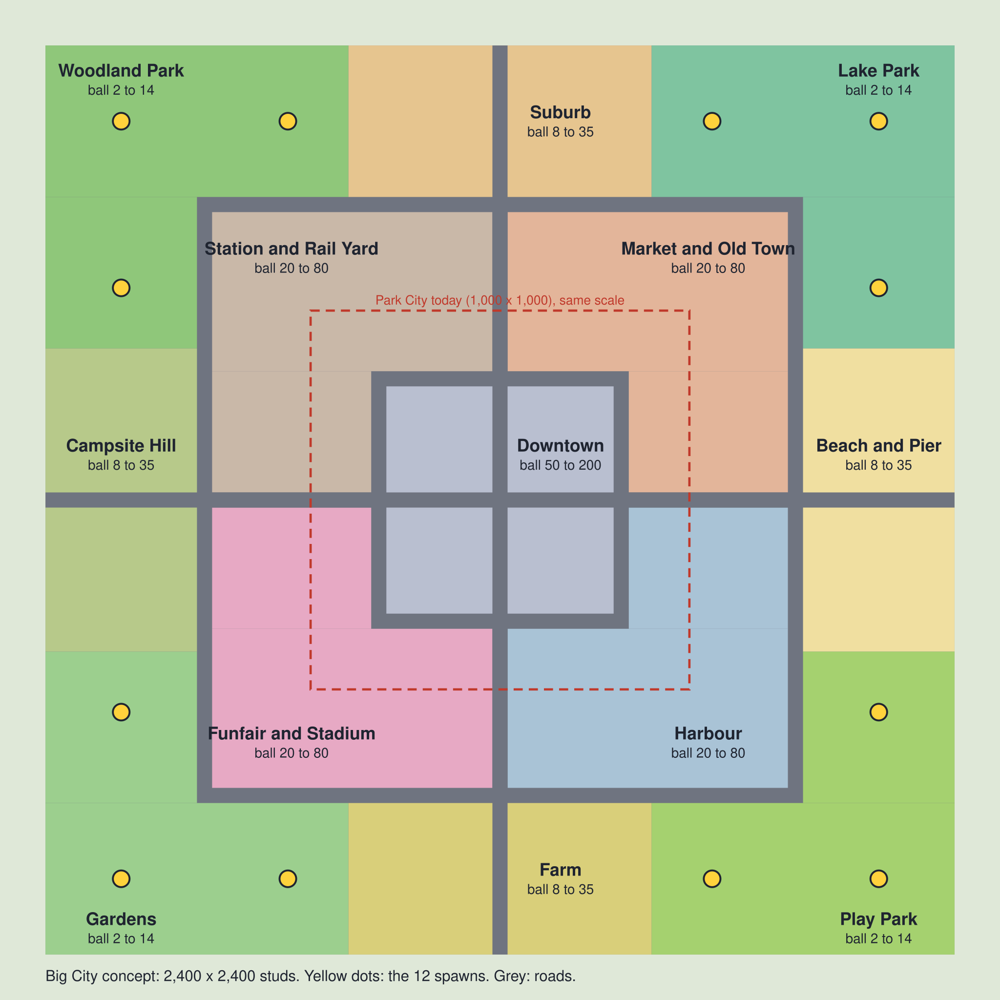

# Big City: the full-size map (proposal)

Status: **proposal**. The owner chose the size on 2026-11-12 (2,400 × 2,400 studs). The districts, their names and
what each one is for are open until the owner approves the overview map below. Nothing here is built.

Park City (09) stays the playable test map until stage 1 of this one can be rolled across. Its rules, toys, events,
scene generator, settle pass and dress table move to the big map; its park quarters become the four start parks.

The picture and the numbers come from `scripts/big_city_layout.py` (`maps/big-city-layout.json`). Change the
script, never the JSON or the SVG.

## 1. Size

| | Park City | Big City |
| --- | --- | --- |
| Playable | 1,000 × 1,000 | **2,400 × 2,400** (`halfExtent` 1,200) |
| Area | 1.0 M studs² | 5.76 M studs² (5.76 ×) |
| Area per ball (12 balls) | 83,000 studs² | 480,000 studs² |
| Edge to edge at the start (18 studs/s) | 56 s | 133 s |
| Edge to edge at the speed cap (32 studs/s) | 31 s | 75 s |
| A start park to the Downtown edge at the cap | about 6 s | about 22 s |

A round is 240 s. A ball cannot see the whole map in one round, so the route it picks matters, and 12 balls start
far enough apart that the first minute is theirs.

## 2. Shape

`m = max(|x|, |z|)`, x east, z south, as in Park City. The city still grows from the outside in: balls start small
in the parks at the edge and end among the towers in the middle, so everyone meets for the last minute.

| Ring | `m` | What | Ball sizes |
| --- | --- | --- | --- |
| **Start parks and sides** | 800 – 1,200 | Four corner parks (3 spawns each) with a side district between each pair | 2 – 35 |
| **Boulevard** | 760 – 800 | A 40-wide loop road with traffic | 8 – 35 |
| **Mid districts** | 340 – 760 | Four city quarters | 20 – 80 |
| **Inner Ring** | 300 – 340 | A 40-wide loop road | 40 – 80 |
| **Downtown** | 0 – 300 | Towers, the Plaza, the Glass Tower | 50 – 200 |

Two 40-wide avenues on the axes run from edge to edge through the Plaza.

## 3. Districts

Each district has one thing found nowhere else, and that thing must be worth a visit at every ball size that
passes through (the lesson of the first Giant Oak, which took 60 × 60 studs and served only a ball of 2 to 8).

| District | Where | Ball | What it is | The one thing |
| --- | --- | --- | --- | --- |
| **Woodland Park** | NW corner | 2 – 14 | Trees, logs, mushrooms, a stream | The Giant Oak shakes food down for whoever is near; the stream carries any ball to the Boulevard |
| **Lake Park** | NE corner | 2 – 14 | Lake, boathouse, picnic lawns | Lily pads for small balls, wading for big ones; the island fountain throws a ball to the Boulevard |
| **Play Park** | SE corner | 2 – 14 | Playground, courts, skate park | Bowl and half-pipes whose launches grow with the ball |
| **Gardens** | SW corner | 2 – 14 | Flower beds, allotments, low hedge maze | A maze a growing ball eats through; the gnome army jackpot |
| **Suburb** | N side | 8 – 35 | Streets of houses with front gardens | Each garden is a food ladder that ends with the house |
| **Beach and Pier** | E side | 8 – 35 | Sand, huts, deckchairs, a pier | The pier ends in a ramp over the water |
| **Farm** | S side | 8 – 35 | Crop fields, barns, tractors | Fields of dense small food; windmill sails fling a ball from a marked spot |
| **Campsite Hill** | W side | 8 – 35 | The map's only hill, tents, caravans | A downhill run, the fastest road on the map |
| **Station and Rail Yard** | NW mid | 20 – 80 | Platforms, carriages, sheds | A train on a loop: food on wheels when big, a hazard when small |
| **Market and Old Town** | NE mid | 20 – 80 | Narrow streets, stalls, shops | The densest food on the map |
| **Harbour** | SE mid | 20 – 80 | Containers, cranes, boats, a ship | Cranes lift a ball from a marked pad; the ship is late food |
| **Funfair and Stadium** | SW mid | 20 – 80 | Rides and a stadium bowl | Ferris wheel, bouncy castle, one coaster rail; the bowl is the Feast arena |
| **Downtown** | centre | 50 – 200 | Tower blocks, the Plaza | The Glass Tower finale; crown zone and meteors live here in the last minute |

Rules carried over from the Park City play sessions:

- Nothing throws, lifts or boosts a ball that only passes near it. The trigger is a marked spot.
- No toy on a road or a path. No two big objects in one place (settle pass, 0 overlaps).
- Fewer, clearer, stronger boosts. A boost the player cannot see the value of is cut.

## 4. Budgets: the open risk

Park City holds 4,771 light objects and 1,251 Part objects against limits of 5,200 and 1,500. At the same density
the big map would hold about **27,500 light and 7,200 Part objects**. That does not fit as it is. The plan to
test in stage 1, before any district is filled:

- Part objects exist only in the districts that have a ball in or next to them; the rest are data until a ball
  comes near. Measure the worst case (12 balls in 12 different places) against the limits in 05.
- The parks and sides carry the small, dense food; the mid districts and Downtown carry few, large objects.
  Density falls towards the middle, so the total is well under the same-density number.
- If the worst case does not fit, the choice is fewer objects per district or a smaller map, and it goes back to
  the owner with the numbers.

## 5. Stages

Every stage ends in a build the owner can play (constitution I and VII). Gate 6 applies to each.

1. **Grey box of the whole map.** Ground, roads, district borders in their colours, 12 spawns, thin food
   everywhere, bots. No art. Answers: does the size feel right, do the travel times work, does the budget plan hold.
2. **The four start parks**, from Park City's park quarters, re-laid to their new shape.
3. **The four side districts.**
4. **The four mid districts.**
5. **Downtown** and the finale.

## 6. For the owner to decide

- The district list and names above (approve, swap or cut).
- Outside in (start in the parks, finish Downtown) or the other way round.
- Whether the avenues cross the Plaza or stop at the Inner Ring.
